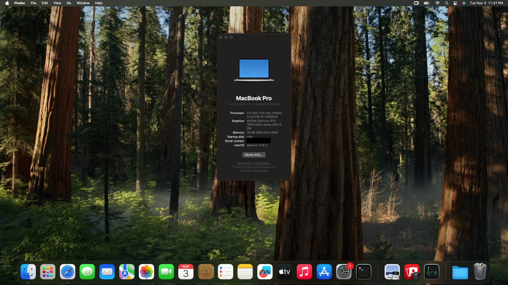

# Lenovo LOQ 15IRX9 — OpenCore Hackintosh EFI

A hardware-specific OpenCore EFI for the **Lenovo LOQ 15IRX9** running **macOS Sequoia 15.8.2**. This configuration has been tested on the below specs. It is not a universal EFI for every LOQ variant or firmware revision.

> **Important:** This repository documents a non-Apple macOS installation. Keep a known-good EFI backup and understand the risks before updating macOS, OpenCore, kexts, ACPI tables or BIOS settings.

## Hardware

| Component | Details |
|---|---|
| Laptop | Lenovo LOQ 15IRX9 |
| CPU | Intel Core i5-13450HX (13th Gen) |
| Dedicated GPU | NVIDIA GeForce RTX 3050 Laptop GPU, 6 GB VRAM |
| Wi-Fi | Realtek RTL8852BE — PCI ID `10EC:B852`, subsystem `17AA:4853` |
| Touchpad | ELAN06FA, I2C |
| SMBIOS model | `MacBookPro16,2` |
| macOS | Sequoia 15.8.2 |
| Bootloader | OpenCore |

## System screenshot



## Feature status

Checkboxes reflect tested on this particular laptop. They are not guarantees for other systems.

### Working

- [x] macOS Sequoia boots successfully.
- [x] Internal laptop display.
- [x] NVIDIA RTX 3050 using the [NullMoth NVIDIA driver](https://github.com/nullmoth/nvidia-macos-driver).
- [x] Camera / webcam.
- [x] Microphone.
- [x] Audio.
- [x] Realtek RTL8852BE Wi-Fi — network scanning and connection tested.
- [x] Bluetooth.
- [x] ELAN06FA I2C touchpad.
- [x] Brightness control (owner reports normal use around 80% brightness).
- [x] Battery status and management.
- [x] Battery charge protection / charge limit configured to 80%.
- [x] All tested USB ports, including USB-C.
- [x] Function keys and Lenovo special hotkeys.
- [x] Windows boot entry retained.
- [x] macOS boot entry works.

### Not working

- [ ] HDMI external display output.
- [ ] Sleep / wake.
- [ ] AirDrop.

### Not tested / not confirmed

- [ ] USB-C DisplayPort Alt Mode / external display output over USB-C.
- [ ] Maximum data-transfer speed of every USB port.
- [ ] SD card reader, if present.
- [ ] Headphone jack and external microphone jack in all use cases.
- [ ] WPA3 and WPA2/WPA3 transition-mode Wi-Fi.
- [ ] Wi-Fi roaming and reconnect behavior after extended sleep/uptime.
- [ ] Continuity, Handoff, Universal Clipboard and other Apple ecosystem features.
- [ ] AirPlay and Sidecar.
- [ ] Every camera resolution and application.
- [ ] Long-duration stress testing and behavior after future macOS updates.
- [ ] Other optional laptop devices not listed above.

## EFI directory structure

This tree reflects the supplied `EFI`.

```text
EFI/
├── .metadata_never_index
├── BOOT/
│   ├── .contentFlavour
│   ├── .contentVisibility
│   └── BOOTx64.efi
└── OC/
    ├── .contentFlavour
    ├── .contentVisibility
    ├── ACPI/
    │   ├── DSDT.aml
    │   ├── SSDT-Disable_Network_RP08.aml  [disabled in config.plist]
    │   ├── SSDT-EC.aml
    │   ├── SSDT-GPI0.aml
    │   ├── SSDT-MCHC.aml
    │   ├── SSDT-PLUG-ALT.aml
    │   ├── SSDT-RTCAWAC.aml
    │   ├── SSDT-SBUS.aml
    │   ├── SSDT-USB-Reset.aml
    │   ├── SSDT-USBX.aml
    │   └── SSDT-XOSI.aml
    ├── Drivers/
    │   ├── HfsPlus.efi
    │   ├── LegionCbmrFix.efi
    │   ├── OpenRuntime.efi
    │   └── ResetNvramEntry.efi
    ├── Kexts/
    │   ├── AMFIPass.kext/
    │   ├── AirPort_RTW89.kext/
    │   │   └── Contents/PlugIns/AirPortRTW89Front.kext/
    │   ├── AppleALC.kext/
    │   ├── BlueToolFixup.kext/
    │   ├── BrightnessKeys.kext/
    │   ├── CpuTopologyRebuild.kext/
    │   ├── HoRNDIS.kext/
    │   ├── IO80211FamilyLegacy.kext/
    │   ├── IOSkywalkFamily.kext/
    │   ├── LOQFanMon.kext/
    │   ├── Lilu.kext/
    │   ├── NVMeFix.kext/
    │   ├── RealtekBluetoothFirmware.kext/
    │   ├── RealtekRTL8111.kext/
    │   ├── RestrictEvents.kext/
    │   ├── SMCBatteryManager.kext/
    │   ├── SMCLightSensor.kext/
    │   ├── SMCProcessor.kext/
    │   ├── SMCSuperIO.kext/
    │   ├── USBToolBox.kext/
    │   ├── UTBDefault.kext/                 [disabled]
    │   ├── UTBMap.kext/
    │   ├── VirtualSMC.kext/
    │   ├── VoodooI2C.kext/
    │   │   └── Contents/PlugIns/
    │   │       ├── VoodooGPIO.kext/
    │   │       ├── VoodooI2CServices.kext/
    │   │       └── VoodooInput.kext/
    │   ├── VoodooI2CHID.kext/
    │   ├── VoodooPS2Controller.kext/
    │   │   └── Contents/PlugIns/
    │   │       ├── VoodooInput.kext/        [disabled]
    │   │       ├── VoodooPS2Keyboard.kext/
    │   │       ├── VoodooPS2Mouse.kext/     [disabled]
    │   │       └── VoodooPS2Trackpad.kext/  [disabled]
    │   ├── WhateverGreen.kext/
    │   ├── XHCI-unsupported.kext/
    │   └── YogaSMC.kext/
    ├── OpenCore.efi
    ├── Resources/
    │   ├── Font/
    │   ├── Image/
    │   └── Label/
    ├── Tools/
    └── config.plist
```

`SSDT-Disable_Network_RP08.aml` is present but disabled. `UTBDefault.kext` and the listed PS/2 mouse/trackpad/input plugin entries are also present but disabled. The enabled state in `config.plist` is authoritative.

## ACPI tables

ACPI tables describe hardware and platform behavior to macOS. The touchpad and Wi-Fi fixes depend on this specific set; do not remove or replace tables casually.

| File | Enabled? | Purpose in this EFI |
|---|:---:|---|
| `DSDT.aml` | Yes | Custom firmware DSDT used by this laptop's ACPI setup. Contains platform-specific device/resource definitions, including the ELAN touchpad path. |
| `SSDT-SBUS.aml` | Yes | Adds/represents the SMBus device for macOS compatibility. |
| `SSDT-Disable_Network_RP08.aml` | **No** | Previously masked the network device under PCIe Root Port 08 by forcing its PCI IDs to `FFFF:FFFF`. It must remain disabled for the RTL8852BE to be visible. |
| `SSDT-EC.aml` | Yes | Provides the Embedded Controller compatibility device expected by macOS. |
| `SSDT-GPI0.aml` | Yes | Provides GPIO-related ACPI support used by I2C devices and interrupt handling. |
| `SSDT-MCHC.aml` | Yes | Adds the MCHC device for macOS platform compatibility. |
| `SSDT-PLUG-ALT.aml` | Yes | Provides CPU plugin-type / power-management ACPI structure used by this configuration. |
| `SSDT-RTCAWAC.aml` | Yes | Provides RTC/AWAC compatibility adjustments. |
| `SSDT-USB-Reset.aml` | Yes | Provides the USB reset-related ACPI table used by this setup. |
| `SSDT-USBX.aml` | Yes | Provides USB power properties for macOS. |
| `SSDT-XOSI.aml` | Yes | Supplies the XOSI method used by ACPI OS-detection logic; relevant to the touchpad resource configuration. |

## UEFI drivers

| Driver | Enabled? | Purpose |
|---|:---:|---|
| `HfsPlus.efi` | Yes | Allows OpenCore to read HFS+ volumes, including relevant macOS recovery/installer media. |
| `OpenRuntime.efi` | Yes | OpenCore runtime support required for memory/runtime services. |
| `ResetNvramEntry.efi` | Yes | Adds a picker entry to reset NVRAM. |
| `LegionCbmrFix.efi` | Yes | Lenovo cloud-recovery/CBMR-related panic workaround included in this EFI. |

## Kernel extensions

Versions and enabled states below are taken from the supplied `config.plist`. Descriptions explain each component's role in this EFI; a kext being present does not mean every feature it could provide has been tested.

| Kext / plugin | Version in EFI | Enabled? | Purpose |
|---|---:|:---:|---|
| `Lilu.kext` | 1.7.3 | Yes | Foundational patching framework used by several macOS compatibility kexts. |
| `IOSkywalkFamily.kext` | Ventura family copy | Yes | Networking framework dependency used by the AirPort_RTW89 Wi-Fi stack. Keep the matching version required by the Wi-Fi driver. |
| `IO80211FamilyLegacy.kext` | Ventura family copy | Yes | Legacy Apple Wi-Fi framework dependency used with AirPort_RTW89. |
| `AMFIPass.kext` | 1.4.1 | Yes | AMFI-related compatibility component required by the selected driver setup. Follow the NullMoth documentation for its security requirements. |
| `AirPort_RTW89.kext` | 0.5.0 (reported installed) | Yes | Realtek RTW89 Wi-Fi driver used for the RTL8852BE adapter. |
| `AirPortRTW89Front.kext` | Bundled plugin | Yes | Front-end/plugin component paired with AirPort_RTW89 for macOS Wi-Fi integration. |
| `AppleALC.kext` | 1.9.9 | Yes | AppleHDA audio patching for supported onboard audio codecs. |
| `BlueToolFixup.kext` | 2.7.3 | Yes | Bluetooth compatibility support for macOS Bluetooth services. |
| `BrightnessKeys.kext` | 1.0.4 | Yes | Brightness-key handling for supported laptop brightness controls. |
| `CpuTopologyRebuild.kext` | 2.0.2 | Yes | Rebuilds CPU topology information for hybrid Intel CPU scheduling/topology compatibility. |
| `NVMeFix.kext` | 1.1.4 | Yes | NVMe power-management and compatibility fixes for supported SSDs. |
| `RealtekBluetoothFirmware.kext` | 1.0.2 | Yes | Firmware support for the Realtek Bluetooth side of the wireless hardware. It is not the Wi-Fi driver. |
| `RealtekRTL8111.kext` | 2.4.2 | Yes | Realtek PCIe Ethernet driver. It does not provide RTL8852BE Wi-Fi. |
| `RestrictEvents.kext` | 1.1.7 | Yes | Workarounds for selected macOS hardware/model restrictions and event behavior. |
| `VirtualSMC.kext` | 1.3.9 | Yes | SMC emulation required for macOS on non-Apple hardware. |
| `SMCBatteryManager.kext` | 1.3.9 | Yes | Battery status and battery-related SMC functionality. |
| `SMCLightSensor.kext` | 1.3.9 | Yes | Light-sensor support where hardware and configuration expose it. |
| `SMCProcessor.kext` | 1.3.9 | Yes | Exposes supported CPU sensor information through VirtualSMC. |
| `SMCSuperIO.kext` | 1.3.9 | Yes | Exposes supported Super I/O sensor information through VirtualSMC. |
| `USBToolBox.kext` | 1.2.0 | Yes | USB port mapping framework used with UTBMap. |
| `UTBMap.kext` | 1.1 | Yes | Machine-specific USB port map; important for the tested USB and USB-C port behavior. |
| `UTBDefault.kext` | 1.0 | **No** | Default USBToolBox map; disabled because the custom UTBMap is enabled. Do not enable both maps together without a reason. |
| `HoRNDIS.kext` | 9.2 | Yes | Android USB RNDIS tethering support. The config comments mark this legacy/experimental for Sequoia. |
| `VoodooI2C.kext` | 2.9.1 | Yes | I2C controller and device support; this build includes native Intel Raptor Lake controller support for PCI ID `8086:7A4C`. |
| `VoodooI2CServices.kext` | 1 | Yes (plugin) | Shared services used by the VoodooI2C stack. |
| `VoodooGPIO.kext` | 1.1 | Yes (plugin) | GPIO support used by compatible I2C devices and interrupt handling. |
| `VoodooInput.kext` | 1.1.7 | Yes (I2C plugin) | Input abstraction used by VoodooI2C input devices. |
| `VoodooI2CHID.kext` | 1 | Yes | HID satellite driver for the ELAN06FA I2C touchpad. |
| `VoodooPS2Controller.kext` | 2.3.8 | Yes | PS/2 controller support, primarily for the internal keyboard path. |
| `VoodooPS2Keyboard.kext` | 2.3.8 | Yes (plugin) | PS/2 keyboard support. |
| `VoodooInput.kext` (PS/2 plugin entry) | 1.1.7 | **No** | Duplicate VoodooInput plugin entry under VoodooPS2Controller; disabled in this config. |
| `VoodooPS2Mouse.kext` | 2.3.8 | **No** | PS/2 mouse support; disabled because the touchpad uses I2C. |
| `VoodooPS2Trackpad.kext` | 2.3.8 | **No** | PS/2 trackpad support; disabled because the touchpad uses I2C. |
| `WhateverGreen.kext` | 1.7.2 | Yes | Graphics property and framebuffer compatibility framework. The RTX 3050 itself relies on the separate NullMoth driver setup. |
| `XHCI-unsupported.kext` | 0.9.2 | Yes | Adds support for selected unsupported XHCI USB controller IDs. |
| `YogaSMC.kext` | 1.5.3 | Yes | Lenovo laptop feature/SMC integration used by this setup. |
| `LOQFanMon.kext` | Repository build (version field not specified) | Yes | LOQ-specific fan monitoring/control component from the repository implementation. |

### Wi-Fi implementation notes

The RTL8852BE is handled by **AirPort_RTW89**, not by `RealtekRTL8111` or `RealtekBluetoothFirmware`. This EFI also includes `IOSkywalkFamily.kext`, `IO80211FamilyLegacy.kext`, and the `AirPortRTW89Front.kext` plugin. These components must remain compatible with one another and with the macOS build.

The owner reports that scanning and joining networks now work on this laptop. AirPort_RTW89 is community/beta software; WPA3, roaming, sleep/wake, and update stability are not confirmed.

### Touchpad implementation notes

The touchpad is identified as `ELAN06FA` on the Intel I2C controller (`8086:7A4C`). The working setup depends on the custom DSDT, XOSI/other ACPI tables, VoodooI2C, VoodooGPIO, VoodooI2CServices, VoodooInput and VoodooI2CHID. Do not remove these components independently.

## Important configuration notes

- Keep `SSDT-Disable_Network_RP08.aml` disabled. In this machine's setup, it masked the Wi-Fi PCI device.
- Keep `UTBDefault.kext` disabled while the custom `UTBMap.kext` is enabled.
- The PS/2 mouse and PS/2 trackpad plugins are disabled; the touchpad is I2C.
- `RealtekRTL8111.kext` is for Ethernet, not Wi-Fi.
- The RTX 3050 setup relies on the separate NullMoth driver and its documented macOS version, boot arguments and security requirements.
- Do not copy this EFI to a different computer without auditing ACPI, USB mapping, device properties, SMBIOS and hardware IDs.
- Keep a known-good backup before changing OpenCore, kexts, ACPI tables, macOS or BIOS settings.

## Generate your own SMBIOS values

**Never reuse another person's `SystemSerialNumber`, `MLB`, `SystemUUID` or `ROM`.** The public `config.plist` should contain placeholders for these unique identifiers. Generate your own values before using this EFI.

The configured model identifier is `MacBookPro16,2`. This product name can remain as shown, but the four unique identity values must be generated for your own installation.

### Using GenSMBIOS

1. Download GenSMBIOS from the official [corpnewt/GenSMBIOS repository](https://github.com/corpnewt/GenSMBIOS).
2. Run the tool and choose the option to generate SMBIOS data.
3. Select `MacBookPro16,2` to match this EFI's `SystemProductName`.
4. Generate a fresh set of values.
5. Open `EFI/OC/config.plist` using ProperTree or another plist editor.
6. Navigate to `PlatformInfo → Generic`.
7. Replace the values as follows:

| `PlatformInfo → Generic` key | Value to enter |
|---|---|
| `SystemProductName` | `MacBookPro16,2` |
| `SystemSerialNumber` | Your newly generated serial number |
| `MLB` | Your newly generated MLB / board serial |
| `SystemUUID` | Your newly generated system UUID |
| `ROM` | Your generated ROM value, represented as the required 6-byte value |

8. Save `config.plist`.
9. Run **OC Validate** (`ocvalidate`) from the same OpenCore release used by this EFI.
10. Keep your generated identifiers private. Do not publish them in screenshots, issue reports, public commits or support messages.

Generating SMBIOS values does not guarantee Apple services such as iMessage or FaceTime will work. Those services have additional requirements. Follow the Dortania SMBIOS guidance carefully and do not sign into an Apple Account until the SMBIOS configuration is correct and you understand the implications.

## Installation and safety checklist

- [ ] Back up the existing EFI before replacing anything.
- [ ] Confirm the target EFI System Partition carefully; do not format or overwrite the Windows EFI by mistake.
- [ ] Generate unique SMBIOS values for your own machine.
- [ ] Review `config.plist` and validate it with the matching OpenCore `ocvalidate`.
- [ ] Confirm the BIOS settings and hardware match this laptop.
- [ ] Keep a bootable recovery USB or known-good EFI available.
- [ ] Test macOS, Windows and any other boot entries after installation.
- [ ] Check compatibility before updating macOS, OpenCore or kexts.

macOS on non-Apple hardware is unsupported by Apple. This EFI is provided for learning, research and personal experimentation. You are responsible for understanding the risks and maintaining backups.

## Credits and references

- [NullMoth 1401](https://github.com/nullmoth/1401) — macOS-on-PC installer/build project.
- [NullMoth NVIDIA macOS driver](https://github.com/nullmoth/nvidia-macos-driver) — NVIDIA driver used for the RTX 3050 setup. Consult its documentation for supported macOS versions, GPU IDs, installation, updates and limitations.
- [OpenCorePkg](https://github.com/acidanthera/OpenCorePkg) — OpenCore bootloader.
- [Dortania OpenCore Install Guide](https://dortania.github.io/OpenCore-Install-Guide/) — OpenCore configuration and SMBIOS guidance.
- [VoodooI2C](https://github.com/VoodooI2C/VoodooI2C) — I2C input stack.
- [USBToolBox](https://github.com/USBToolBox) — USB mapping framework.
- [GenSMBIOS](https://github.com/corpnewt/GenSMBIOS) — generate unique SMBIOS values.

Third-party kexts and tools retain their own licenses and attribution requirements. Review their upstream repositories before redistributing binaries.

## Caution / Disclaimer

**Use this EFI entirely at your own risk. I am not responsible for anything that may happen from using, modifying, or installing it, including data loss, boot failure, system instability, hardware issues, or damage.** Always keep backups and make sure you understand the changes before proceeding.